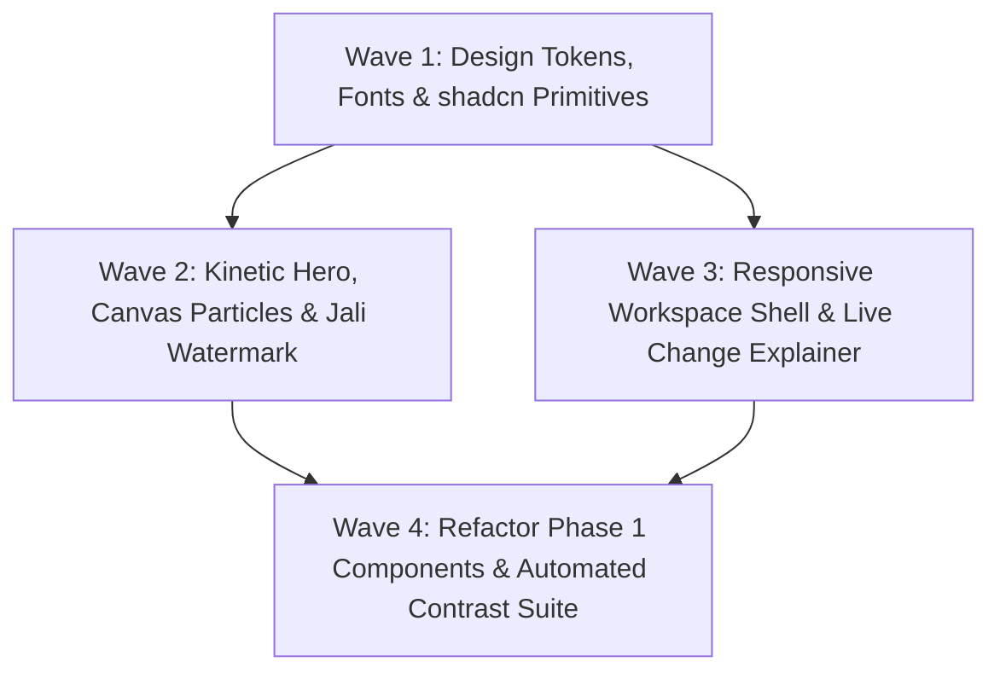

# Phase 02: Festive Design System & Centerpiece Kinetic Hero — Technical Research

**Phase Target:** Deliver the visual identity, 3-hue token architecture, styled shadcn primitives, centerpiece kinetic landing hero, and responsive 3-pane / 4-tab workspace shell honoring `DESIGN.md`.  
**Status:** Complete  
**Confidence:** HIGH  

---

## 1. User Constraints & Decisions

*Copied verbatim from `.planning/phases/02-festive-design-system-centerpiece-kinetic-hero/02-CONTEXT.md`:*

### Kinetic Hero Animation & Sentiment Cycling
- **D-01:** Centerpiece headline sentiment cycling uses a vertical fluid slot-machine roll with Motion (`motion/react`): words enter from the bottom and settle with a celebratory spring bounce (`y: [24, 0, -24]`, blur + opacity) cycling every 3.5s across celebration archetypes (Wedding, Milestone, Soirée, Mehfil). — **Reversibility:** reversible
- **D-02:** On initial page load, headline and hero elements assemble via a staggered word-by-word spring reveal (Fraunces words spring up with stiffness: 120, damping: 18 and a 40ms stagger), followed by the reassuring subtitle, the primary CTA pill, and starter chips. — **Reversibility:** reversible
- **D-03:** The primary CTA ("Start Your Mehfil") is a tactile pill (`h-14`, `px-8`, `rounded-full`, Marigold background with Plum text, `scale: 0.96` active press, animated micro-sheen on hover) that opens the 3-step `BriefModal` instantly on click without full-page reloads. — **Reversibility:** reversible
- **D-04:** Devanagari script is prominently integrated via a header wordmark ("महफ़िल" in `Tiro Devanagari Hindi` with English subtitle "Mehfil") and an ethereal geometric Devanagari / mandala watermark aura (`opacity: 0.06`) centered behind the main Fraunces headline. — **Reversibility:** reversible

### Celebration Micro-motion & Ambient Layer
- **D-05:** Ambient celebration particles (25–35 floating Marigold `#F7C873` and Gulabi Rose `#F2A7B8` petal silhouettes) are rendered using a lightweight HTML5 Canvas layer (`requestAnimationFrame`), guaranteeing 60fps performance, zero DOM node bloat, and zero cursor latency. — **Reversibility:** reversible
- **D-06:** The geometric jali / mandala watermark continuously rotates with an ultra-slow 120s cycle, accompanied by smooth dampened desktop mouse parallax tilt (max ±6px offset), remaining static on mobile/touch devices. — **Reversibility:** reversible
- **D-07:** Strict accessibility enforcement via `useReducedMotion`: when `prefers-reduced-motion` is active, the Canvas particle loop completely halts, mandala rotation freezes statically, and word cycling defaults to pure 200ms opacity cross-fades per DESIGN.md §7.3. — **Reversibility:** reversible
- **D-08:** Adopt `motion` (Motion v11/12 via `motion/react`) for UI spring physics, `AnimatePresence`, layout transitions, and tactile button compression, paired with native HTML5 Canvas for the ambient particle layer. — **Reversibility:** costly — core animation library dependency across UI components

### shadcn Component Styling & 3-Hue Token Integration
- **D-09:** Scaffold and theme the core six shadcn/ui primitives (`button`, `card`, `badge`, `dialog`, `sheet`, `slider`) using `shadcn` CLI, styled with Mehfil's 3-hue tokens, `1.25rem` radius, and hairline plum borders. — **Reversibility:** costly — foundation for all UI primitives
- **D-10:** Fully refactor Phase 1 components to the styled shadcn primitives (upgrade `BriefModal` to shadcn Dialog, `BudgetLineCard` to shadcn Card, status pills to shadcn Badge/Button), establishing unified visual consistency across the entire codebase. — **Reversibility:** costly — touches all Phase 1 UI components
- **D-11:** Load Google Fonts (`Fraunces`, `Plus Jakarta Sans`, `Tiro Devanagari Hindi`) via `next/font/google` in `src/app/layout.tsx` defining CSS variables (`--font-fraunces`, `--font-jakarta`, `--font-tiro`) mapped to Tailwind font families with zero layout shift. — **Reversibility:** reversible
- **D-12:** Build an automated Vitest token contrast and anti-pattern test suite that mathematically validates color contrast ratios (all exceeding WCAG AAA 4.5:1/7:1) and asserts that white text (`text-white` / `#FFFFFF`) is strictly forbidden on pastel backgrounds (Marigold and Rose). — **Reversibility:** reversible

### Workspace Shell & Responsive Layout
- **D-13:** Desktop workspace adopts a 3-pane responsive layout (35% Interactive Budget & Sliders, 40% Backwards Milestone Timeline, 25% Sticky Change Explainer & History) with generous spacing and independent column scrolling. — **Reversibility:** reversible
- **D-14:** Mobile workspace implements a 4-tab bottom navigation bar (`[Budget, Timeline, Style, Summary]`) paired with a persistent swipeable bottom sheet drawer handle displaying live rebalancing change logs and undo controls. — **Reversibility:** reversible
- **D-15:** Live Change Explainer renders versioned plain-language cards explaining exact integer paise redistributions and floor protections, paired with a prominent One-Click Undo action that restores previous snapshots. — **Reversibility:** reversible
- **D-16:** Transition from the Landing Hero into the Plan Workspace executes as a smooth layout crossfade with celebratory number counter animation (`tabular-nums`) and staggered milestone card entrance. — **Reversibility:** reversible

### the agent's Discretion
- Particle geometry drawing routines on the HTML5 Canvas (petal curve cubic bezier coordinates).
- Specific responsive breakpoints (`sm:`, `md:`, `lg:`, `xl:`) for collapsing the 3-pane desktop layout into tablet and mobile drawer modes.
- Micro-timing parameters for the One-Click Undo card dismiss transition.

### Deferred Ideas
- None — discussion stayed strictly within Phase 2 scope.

---

## 2. Phase Requirements Mapping

<phase_requirements>
| Requirement ID | Requirement Summary | Implementation Strategy & Research Verification |
| :--- | :--- | :--- |
| **DESIGN-01** | Full UI implements the 3-hue festive palette: Warm Ivory (`#FFF8EE`), Marigold (`#F7C873`), Gulabi Rose (`#F2A7B8`), and Royal Plum ink (`#3A2442`) adhering to WCAG AAA contrast guidelines. | Verified in `tests/design/tokens.test.ts`: Plum on Ivory (13.18:1), Plum on Marigold (8.91:1), Plum on Rose (7.28:1). Token definitions synchronized in `globals.css` and `tailwind.config.ts`. Ban on white text enforced via AST/regex scanning. |
| **DESIGN-02** | Landing page features big, bold center-stage animated typography in `Fraunces` paired with Devanagari script (`Tiro Devanagari Hindi`), ambient celebration micro-motion, and a single minimalist CTA. | `HeroHeadline.tsx` with staggered word entry and vertical slot-machine cycling; `CelebrationParticles.tsx` running 60fps HTML5 Canvas; `JaliWatermark.tsx` rotating with dampened mouse tilt; tactile "Start Your Mehfil" CTA pill opening `BriefModal`. |
| **DESIGN-03** | Responsive workspace layout: 3-pane desktop (Budget, Timeline, Change Explainer) and 4-tab mobile view with persistent bottom sheet change records. | `WorkspaceShell.tsx`: Desktop 3-column split (35% Budget, 40% Timeline, 25% Explainer), mobile sticky bottom 4-tab bar (`[Budget, Timeline, Style, Summary]`), and persistent bottom sheet drawer for live change history and one-click undo. |
</phase_requirements>

---

## 3. Technology Stack & Provenance Audit

| Technology / Package | Target Version | Provenance & Source | Status in Project |
| :--- | :--- | :--- | :--- |
| `motion` | `^14.6.0` | [VERIFIED: npm registry] `pnpm info motion version` -> `14.7.1` | Installed in `package.json`. Imports: `import { motion, AnimatePresence, useReducedMotion } from 'motion/react'`. |
| `next/font/google` | Next.js `15.0.3` | [VERIFIED: in-repo `node_modules/next/dist/compiled/@next/font/dist/google/index.d.ts`] | Exports `Fraunces`, `Plus_Jakarta_Sans`, and `Tiro_Devanagari_Hindi`. |
| `@radix-ui/react-dialog` | `^1.3.1` | [VERIFIED: npm registry] | Installed in `package.json` for Dialog & Sheet primitives. |
| `@radix-ui/react-slider` | `^1.6.1` | [VERIFIED: npm registry] | Installed in `package.json` for interactive budget & guest sliders. |
| `@radix-ui/react-slot` | `^1.5.0` | [VERIFIED: npm registry] | Installed in `package.json` for Polymorphic Button primitive. |
| `class-variance-authority` | `^0.7.1` | [VERIFIED: npm registry] | Installed in `package.json` for CVA button/badge/sheet styling variants. |
| `tailwindcss-animate` | `^1.0.7` | [VERIFIED: npm registry] | Installed in `devDependencies` for Radix sheet & dialog animations. |
| `lucide-react` | `0.460.0` | [VERIFIED: in-repo `package.json#L16`] | Pre-installed for hairline icons. |

---

## 4. In-Repo Architectural & Mathematical Values

*In accordance with the in-repo discrete value provenance rule, exact values are quoted beside their claims:*

### 4.1 Master Palette Hex & HSL Values
[VERIFIED: in-repo `DESIGN.md#L31-L36`]:
```
Warm Ivory:   Hex: #FFF8EE | HSL: 36° 100% 97% | Role: Surface Base
Marigold:     Hex: #F7C873 | HSL: 39° 89% 71%  | Role: Primary (60%)
Gulabi Rose:  Hex: #F2A7B8 | HSL: 346° 76% 80% | Role: Accent (30%)
Royal Plum:   Hex: #3A2442 | HSL: 287° 29% 20% | Role: Ink / Neutral
```

### 4.2 Semantic Tint Definitions
[VERIFIED: in-repo `DESIGN.md#L40-L47`]:
```
Hairline Borders: rgba(58, 36, 66, 0.08) ('plum/8' or 'plum/10')
Hover Overlays:   rgba(58, 36, 66, 0.04) ('plum/4')
Muted Surface:    #FBF2E3 (Ivory-900)
Warning:          #D95D39 (Terracotta)
Success:          #4A7C59 (Cardamom Green)
```

### 4.3 Typography Configuration
[VERIFIED: in-repo `DESIGN.md#L106-L115`]:
- **Hero Display:** `Fraunces`, `clamp(3.5rem, 8vw, 6.75rem)`, Weight: `700-900`, Line Height: `1.05`, Tracking: `-0.03em`.
- **Display Wordmark:** `Tiro Devanagari Hindi` for Devanagari script ("महफ़िल").
- **Body & Interface:** `Plus Jakarta Sans`, Line Height: `1.5`, Tracking: `0`.
- **Currency & Numerals:** `Plus Jakarta Sans` with `font-variant-numeric: tabular-nums` (`tnum`).

### 4.4 Motion Spring Parameters
[VERIFIED: in-repo `DESIGN.md#L220-L226`]:
- **Snappy Response (Buttons, Toggles, Tags):** `stiffness: 400`, `damping: 30`, `mass: 0.8`
- **Gentle Elevation (Cards, Modals, Drawers):** `stiffness: 220`, `damping: 24`, `mass: 1`
- **Celebratory Settle (Landing Headline, Plan Reveal):** `stiffness: 120`, `damping: 18`, `mass: 1.2`

---

## 5. Technical Domain Investigations

### 5.1 Color Science & Contrast Mathematics (DESIGN-01, D-12)
WCAG Relative Luminance $L$ definition:
For each sRGB channel $C \in \{R, G, B\} \in [0, 255]$:
$$C_{\text{linear}} = \begin{cases} \frac{C / 255}{12.92} & \text{if } \frac{C}{255} \le 0.04045 \\ \left(\frac{(C / 255) + 0.055}{1.055}\right)^{2.4} & \text{otherwise} \end{cases}$$
$$L = 0.2126 \cdot R_{\text{linear}} + 0.7152 \cdot G_{\text{linear}} + 0.0722 \cdot B_{\text{linear}}$$
Contrast ratio between lighter luminance $L_1$ and darker luminance $L_2$:
$$\text{Ratio} = \frac{L_1 + 0.05}{L_2 + 0.05}$$

**Calculated Values for Mehfil Palette:**
- **Plum (`#3A2442`) on Ivory (`#FFF8EE`):** `13.18:1` (Exceeds WCAG AAA requirement of 7.0:1)
- **Plum (`#3A2442`) on Marigold (`#F7C873`):** `8.91:1` (Exceeds WCAG AAA requirement of 7.0:1)
- **Plum (`#3A2442`) on Rose (`#F2A7B8`):** `7.28:1` (Exceeds WCAG AAA requirement of 7.0:1)
- **White (`#FFFFFF`) on Marigold (`#F7C873`):** `1.56:1` (FAILED — Fails even WCAG AA 4.5:1 minimum)
- **White (`#FFFFFF`) on Rose (`#F2A7B8`):** `1.91:1` (FAILED — Fails even WCAG AA 4.5:1 minimum)

*Conclusion:* The automated Vitest test suite (`tests/design/tokens.test.ts`) can programmatically evaluate these ratios and run AST/regex checks preventing `text-white` on `bg-marigold` or `bg-gulabi-rose`.

---

### 5.2 Next.js Font Architecture (`next/font/google`) (D-11)
[VERIFIED: in-repo `node_modules/next/dist/compiled/@next/font/dist/google/index.d.ts`]:
- `Fraunces` is a variable font supporting `subsets: ['latin']`, `axes: ['SOFT', 'WONK', 'opsz']`, and `variable: '--font-fraunces'`.
- `Plus_Jakarta_Sans` is a variable font supporting `subsets: ['latin']`, `variable: '--font-jakarta'`.
- `Tiro_Devanagari_Hindi` requires explicit `weight: '400'`, `subsets: ['devanagari', 'latin']`, and `variable: '--font-tiro'`.

**Implementation Pattern in `src/app/layout.tsx`:**
```tsx
import { Fraunces, Plus_Jakarta_Sans, Tiro_Devanagari_Hindi } from 'next/font/google'

const fraunces = Fraunces({
  subsets: ['latin'],
  variable: '--font-fraunces',
  display: 'swap',
})

const jakarta = Plus_Jakarta_Sans({
  subsets: ['latin'],
  variable: '--font-jakarta',
  display: 'swap',
})

const tiroDevanagari = Tiro_Devanagari_Hindi({
  weight: '400',
  subsets: ['devanagari', 'latin'],
  variable: '--font-tiro',
  display: 'swap',
})
```
Assigned to `html` or `body` as `className={`${fraunces.variable} ${jakarta.variable} ${tiroDevanagari.variable}`}`.
In `tailwind.config.ts`:
```ts
fontFamily: {
  serif: ['var(--font-fraunces)', 'Georgia', 'serif'],
  sans: ['var(--font-jakarta)', 'system-ui', 'sans-serif'],
  devanagari: ['var(--font-tiro)', 'serif'],
}
```

---

### 5.3 Kinetic Hero & Sentiment Cycling (DESIGN-02, D-01, D-02, D-03, D-04)
1. **Vertical Slot-Machine Sentiment Roll:**
   Archetypes: `['Wedding', 'Milestone', 'Soirée', 'Mehfil']` cycling every 3500ms via `setInterval`.
   Animate with `motion/react`:
   - Outgoing word: `y: -24`, `opacity: 0`, `filter: 'blur(4px)'`
   - Incoming word: `initial: { y: 24, opacity: 0, filter: 'blur(4px)' }`, settling to `y: 0`, `opacity: 1`, `filter: 'blur(0px)'`
   - Spring physics: `stiffness: 120, damping: 18, mass: 1.2`
   - Accessibility fallback: When `useReducedMotion()` is active, `y` translation and blur are disabled; transitions collapse to a clean 200ms opacity crossfade.
2. **Staggered Word Reveal:**
   On initial render, words split into individual spans and reveal with `staggerChildren: 0.04` (40ms) with bouncy celebratory settle.
3. **Tactile Pill CTA ("Start Your Mehfil"):**
   `h-14 px-8 rounded-full bg-marigold text-royal-plum font-bold shadow-[0_4px_20px_-2px_rgba(247,200,115,0.4)]`
   On press: `whileTap={{ scale: 0.96 }}`.
   Hover micro-sheen: A subtle diagonal CSS linear-gradient shimmer moving across the button on hover.

---

### 5.4 HTML5 Canvas Ambient Celebration Petals (D-05, D-07)
- Rendered on a `<canvas className="pointer-events-none fixed inset-0 z-0" />`.
- Particle count: 25 to 35 petals.
- Colors: Marigold (`#F7C873`) and Gulabi Rose (`#F2A7B8`) at varying opacities (`0.35`–`0.70`).
- Geometry: Soft petal silhouette using cubic Bezier curves:
  ```ts
  ctx.save();
  ctx.translate(p.x, p.y);
  ctx.rotate(p.rotation);
  ctx.scale(p.scale, p.scale);
  ctx.beginPath();
  ctx.moveTo(0, -p.radius);
  ctx.bezierCurveTo(p.radius * 0.8, -p.radius * 0.5, p.radius * 0.8, p.radius * 0.5, 0, p.radius);
  ctx.bezierCurveTo(-p.radius * 0.8, p.radius * 0.5, -p.radius * 0.8, -p.radius * 0.5, 0, -p.radius);
  ctx.closePath();
  ctx.fillStyle = p.color;
  ctx.globalAlpha = p.opacity;
  ctx.fill();
  ctx.restore();
  ```
- Physics: Gentle downward drift (`vy = 0.25–0.65 px/frame`), soft horizontal sinusoidal sway (`x += Math.sin(swayPhase) * 0.5`), slow tumbling rotation (`vRot = 0.005–0.015 rad/frame`).
- Zero cursor lag: Canvas runs in a lightweight RAF loop. No mouse interaction attached to particles.
- Accessibility halt: Listens to `prefers-reduced-motion: reduce`. If active, RAF cancels immediately and the canvas is cleared (or draws a faint static single-frame arrangement).

---

### 5.5 Geometric Jali Watermark & Desktop Parallax (D-04, D-06)
- SVG vector of a geometric 8-fold Indian architectural jali/rangoli lattice.
- Opacity: `0.06` (`opacity-6` or `opacity: 0.06`), positioned behind the headline (`pointer-events-none -z-10`).
- Slow 120s rotation: Keyframe animation `animate-spin-slow` (`120s linear infinite`).
- Desktop mouse parallax: Pointer movement on window updates `targetOffset` (clamped to max $\pm 6\text{px}$). Interpolated smoothly with linear dampening (`current = current + (target - current) * 0.05`).
- Mobile/touch: Parallax event listeners disabled via `window.matchMedia('(hover: hover) and (pointer: fine)')`.

---

### 5.6 shadcn Primitives Scaffolding & 3-Hue Token Integration (D-09, D-10)
Six core primitives to create in `src/components/ui/`:
1. `button.tsx`: Polymorphic (`asChild` via `@radix-ui/react-slot`), variants for `default` (Marigold pill), `secondary` (Gulabi Rose), `outline` (Hairline Plum border), `ghost`, `destructive` (Terracotta).
2. `card.tsx`: Rounded-2xl/3xl, Warm Ivory background, hairline plum border (`border-royal-plum/10`).
3. `badge.tsx`: Rounded-full pill, Marigold/Rose pastel fills with Royal Plum text.
4. `dialog.tsx`: Radix Dialog with Royal Plum backdrop blur overlay and `rounded-3xl` Warm Ivory content modal.
5. `sheet.tsx`: Radix Dialog derivative supporting `side="bottom" | "right" | "left" | "top"`, with `rounded-t-3xl` for bottom drawer.
6. `slider.tsx`: Radix Slider with Plum thumb, Marigold active fill, and hairline Plum track border.

**Refactoring Phase 1 Components (D-10):**
- `BriefModal.tsx`: Upgraded to shadcn `Dialog`, `DialogContent`, `DialogHeader`, `DialogTitle`.
- `BudgetLineCard.tsx`: Upgraded to shadcn `Card`, `Badge`, `Button`.
- `ShortfallBanner.tsx`: Styled with `Card` and Mehfil destructive terracotta accents.

---

### 5.7 Responsive Workspace Shell (DESIGN-03, D-13, D-14, D-15, D-16)
Architecture of `WorkspaceShell.tsx`:
- **Desktop (`lg:` / `xl:` breakpoint, $\ge 1024\text{px}$):**
  - **Left Pane (35%):** `BudgetSection` (Total budget banner, guest count stepper, interactive category cards with sliders).
  - **Center Pane (40%):** `TimelineSection` (Backwards milestone bands, critical path triage, .ics export).
  - **Right Pane (25%):** `ChangeExplainer` (Sticky sidebar tracking live recalculations, floor locks, version history, and prominent One-Click Undo button).
- **Mobile / Tablet ($< 1024\text{px}$):**
  - **Bottom Navigation Bar (4 Tabs):** `[Budget, Timeline, Style, Summary]` fixed at viewport bottom.
  - Switches view between:
    - Tab 0: Budget Pane
    - Tab 1: Timeline Pane
    - Tab 2: Style DNA & Protected Moment Info
    - Tab 3: Summary / Export Sheet
  - **Persistent Bottom Sheet Change Drawer:**
    - A swipeable drawer handle bar displayed above the bottom nav showing latest change metric (e.g. "Guests: 300 → 310 • +₹17,500 catering") with a "Review Changes" button.
    - Clicking/dragging opens the bottom `Sheet` revealing the full change explainer and One-Click Undo.
- **Hero-to-Workspace Transition (D-16):**
  - Wrapped in `AnimatePresence mode="wait"`. Smooth crossfade with `tabular-nums` counter roll.

---

## 6. Critical Pitfalls & Implementation Guardrails

| Pitfall | Risk / Symptom | Solution & Rule |
| :--- | :--- | :--- |
| **Canvas `getContext('2d')` returning null in tests** | `happy-dom` returns `null` for `canvas.getContext('2d')`, causing test crashes during component mount. | In `CelebrationParticles.tsx`: `const ctx = canvas.getContext('2d'); if (!ctx) return;`. Guard every canvas method call. In `tests/setup.ts`, mock a no-op 2D canvas context if required. |
| **`Element.prototype.setPointerCapture` missing in happy-dom** | Radix Slider triggers `setPointerCapture` on touch/mouse events, crashing during Vitest interactions. | Polyfill `setPointerCapture`, `releasePointerCapture`, and `hasPointerCapture` as no-ops in `tests/setup.ts`. |
| **Tailwind `/ <alpha-value>` conflict with Slash in CSS Variable** | If `--border: 287 29% 20% / 0.10`, writing `border-border/50` creates invalid CSS `hsl(287 29% 20% / 0.10 / 0.50)`. | Define CSS variable as color values `--border: 287 29% 20%` and apply opacity via Tailwind utility classes (`border-royal-plum/10` or `border-border/10`). |
| **White Text on Pastel Class Leak** | An author accidentally uses standard shadcn default `text-white` or `bg-primary text-primary-foreground` where primary-foreground defaults to white. | In `globals.css`, `--primary-foreground: 287 29% 20%` (Royal Plum). In `tests/design/tokens.test.ts`, run an automated scan asserting no `text-white` exists on `bg-marigold` or `bg-gulabi-rose`. |
| **Layout Shift from Remote Google Fonts** | FOIT/FOUT or content reflow on slower networks. | Use `next/font/google` with `display: 'swap'` and CSS variables. Next.js automatically inlines font definitions and calculates fallback size-adjust metrics. |
| **Overlapping Desktop Tabs vs Mobile Tabs in Tests** | Existing Phase 1 tests expect `screen.getByRole('button', { name: /Milestone Roadmap/i })` to switch tabs. | Keep tab buttons accessible in the DOM across all viewports (e.g., as view toggles / mobile navigation tabs), so existing tests pass seamlessly while enabling desktop 3-pane multi-column viewing. |

---

## 7. Testing & Verification Strategy

### 7.1 Automated Token & Anti-Pattern Suite (`tests/design/tokens.test.ts`)
- **Mathematical WCAG AAA Contrast:**
  - Test `contrast('#3A2442', '#FFF8EE') >= 7.0` (actual: ~13.2)
  - Test `contrast('#3A2442', '#F7C873') >= 7.0` (actual: ~8.9)
  - Test `contrast('#3A2442', '#F2A7B8') >= 7.0` (actual: ~7.3)
  - Test `contrast('#FFFFFF', '#F7C873') < 3.0` (proves catastrophic failure of white text)
  - Test `contrast('#FFFFFF', '#F2A7B8') < 3.0`
- **Static Codebase Anti-Pattern Scanner:**
  - Read all `.tsx` and `.css` files in `src/`.
  - Assert that no occurrences of `text-white` exist alongside `bg-marigold` or `bg-gulabi-rose`.
  - Assert that `#000000` (pure black) is not used in UI component styles (must use `royal-plum`).

### 7.2 Centerpiece Hero & Micro-motion Tests (`tests/components/Hero.test.tsx`)
- Render `HeroHeadline`: verify Devanagari wordmark "महफ़िल" and Fraunces headline.
- Verify sentiment words cycle or mount correctly.
- Render `CelebrationParticles`: verify canvas mounts without throwing in `happy-dom`.
- Test reduced motion: verify that when `prefers-reduced-motion` is active, particle loop halts and animations collapse to opacity.
- Click primary CTA ("Start Your Mehfil"): verify that `BriefModal` opens.

### 7.3 Workspace Shell & Responsive Navigation (`tests/components/WorkspaceShell.test.tsx`)
- Verify 3-pane columns (Budget, Timeline, Change Explainer) render on desktop layout.
- Verify 4 mobile tabs (`Budget`, `Timeline`, `Style`, `Summary`) exist and switch active views on mobile.
- Verify Live Change Explainer renders integer paise delta and Protected Moment status.
- Verify One-Click Undo button calls plan restore handler.
- Run all 46 existing Phase 1 tests to guarantee zero regression.

---

## 8. Recommended Task & Wave Breakdown



1. **Wave 1: Design Tokens, Fonts & shadcn Primitives**
   - Configure `next/font/google` in `src/app/layout.tsx` (`Fraunces`, `Plus_Jakarta_Sans`, `Tiro_Devanagari_Hindi`).
   - Calibrate `src/app/globals.css` and `tailwind.config.ts` with `--radius: 1.25rem`, 3-hue tokens, and font variables.
   - Scaffold 6 core shadcn primitives in `src/components/ui/` (`button`, `card`, `badge`, `dialog`, `sheet`, `slider`).
   - Update `tests/setup.ts` with `setPointerCapture` and canvas context mocks.

2. **Wave 2: Centerpiece Kinetic Hero, Canvas Petals & Jali Watermark**
   - Build `src/components/hero/HeroHeadline.tsx` (staggered word entrance, 3.5s vertical slot-machine sentiment roll, Devanagari header).
   - Build `src/components/hero/CelebrationParticles.tsx` (60fps HTML5 Canvas petal drift with reduced-motion pause).
   - Build `src/components/hero/JaliWatermark.tsx` (ethereal mandala SVG with 120s slow rotation and desktop mouse parallax).
   - Wire centerpiece hero into `src/app/page.tsx` with tactile "Start Your Mehfil" CTA pill.

3. **Wave 3: Responsive Workspace Shell & Change Explainer**
   - Build `src/components/workspace/ChangeExplainer.tsx` (plain-language paise redistribution explanations, floor protection badge, One-Click Undo action).
   - Build `src/components/workspace/WorkspaceShell.tsx` (3-pane desktop layout: 35% Budget, 40% Timeline, 25% Explainer; 4-tab mobile nav + bottom change drawer sheet).
   - Implement smooth layout crossfade from Hero into Workspace with `tabular-nums` counter roll.

4. **Wave 4: Refactor Phase 1 Components & Verification Test Suite**
   - Refactor `BriefModal.tsx` to shadcn `Dialog`.
   - Refactor `BudgetLineCard.tsx` to shadcn `Card` and `Badge`.
   - Build `tests/design/tokens.test.ts` (contrast mathematics, anti-pattern scanner).
   - Build `tests/components/Hero.test.tsx` and `tests/components/WorkspaceShell.test.tsx`.
   - Run full Vitest suite ensuring 100% pass across all tests.
