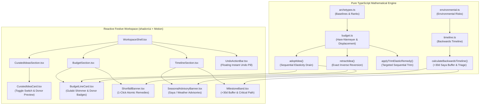

# Phase 5: Budget Invariants, Protected Moments & Idea Displacement - Research

**Phase:** 5 — Budget Invariants, Protected Moments & Idea Displacement  
**Status:** Complete  
**Confidence:** HIGH  
**Canonical Sources:**
- ADR-0001: Deterministic Baseline First (`docs/adr/0001-deterministic-baseline-first.md`) [VERIFIED: docs/adr/0001-deterministic-baseline-first.md]
- ADR-0002: Permissive Shortfall State with Deterministic Remedies (`docs/adr/0002-permissive-shortfall-with-remedies.md`) [VERIFIED: docs/adr/0002-permissive-shortfall-with-remedies.md]
- ADR-0004: Idea Adoption via Budget-Neutral Displacement (`docs/adr/0004-idea-displacement-with-protected-immunity.md`) [VERIFIED: docs/adr/0004-idea-displacement-with-protected-immunity.md]
- ADR-0005: Compressed Mode for Short-Notice Timeline Triage (`docs/adr/0005-compressed-mode-timeline-triage.md`) [VERIFIED: docs/adr/0005-compressed-mode-timeline-triage.md]
- Design Specification: Festive 3-Hue System, Plum Ink, Micro-haptics (`DESIGN.md`) [VERIFIED: DESIGN.md:30-90]
- Phase 5 Decisions: User Decisions from `/gsd-discuss-phase` (`.planning/phases/05-budget-invariants-protected-moments-idea-displacement/05-CONTEXT.md`) [VERIFIED: 05-CONTEXT.md:1-84]
- Requirements: BUDGET-03, BUDGET-04, MOMENT-02, MOMENT-03, IDEA-01, IDEA-02, IDEA-03, TIME-02, TIME-03 (`.planning/REQUIREMENTS.md`) [VERIFIED: REQUIREMENTS.md:21-55]

---

## Executive Summary

Phase 5 completes Mehfil's dynamic mathematical core. In Phases 1 through 4, we built deterministic baseline apportionment, responsive design tokens, Supabase anonymous capability persistence, and the multi-agent Style DNA modulation pipeline. Phase 5 operationalizes the remaining mathematical contracts that guarantee financial safety and authentic Indian celebration intelligence:

1. **Idea Adoption via Zero-Sum Displacement (IDEA-01, IDEA-02, IDEA-03, ADR-0004):** When an organizer toggles on a curated celebration enhancement (e.g. "Kulhad Chai Bar" at ₹15,000), funds are displaced deterministically from flexible lines in strict elasticity rank order (Misc $\rightarrow$ Entertainment $\rightarrow$ Decor), respecting 40% baseline floors. Toggling off restores the exact paise to the exact donor lines in reverse order (1-click undo).
2. **Protected Moment Mathematical Immunity & Tactile Highlights (MOMENT-02, MOMENT-03, ADR-0004):** The designated Protected Moment allocation is mathematically immune to downward re-balancing or displacement. The UI reinforces this inviolability through Gulabi Rose highlights, a lock shimmer effect, `navigator.vibrate` micro-haptics, and explicit immunity tooltips.
3. **Permissive Shortfall State with Deterministic Remedies (BUDGET-03, BUDGET-04, ADR-0002):** When guest scaling or idea adoption exceeds flexible capacity, the engine does not block user interaction. Instead, it enters an Infeasible State, calculates three deterministic remedies (increase budget, reduce guests, sequential elasticity trim), supports 1-click atomic application, and persists non-blockingly with calm advisory badges.
4. **Environmental Date Risks & Calendar Intelligence (TIME-02, TIME-03, ADR-0005):** Pure UTC date engine detects peak Indian wedding seasons (winter Saya Nov–Feb, summer Saya Apr–May), monsoon risks (Jun–Aug), extreme summer heat (May–Jun), and dry/holiday dates. It automatically expands milestone lead times (+30d peak buffer) and presents a calm, reassuring triage view for short-notice compressed timelines.

---

## 1. Mathematical Architecture & Zero-Sum Displacement

### 1.1 Elasticity Rankings & Displacement Order (BUDGET-04, ADR-0004)
[VERIFIED: src/lib/engine/types.ts:25-35, src/lib/engine/archetypes.ts:30-74, 05-CONTEXT.md:29]

The engine categorizes budget lines into four immutable types: `per_guest`, `fixed`, `flexible`, and `buffer`. Only lines marked `flexible` that are **NOT** marked `isProtected` are eligible to donate funds to adopted ideas.

In `src/lib/engine/archetypes.ts`, each archetype assigns `elasticityRank` to flexible lines (lower rank number = trimmed first):
- **Rank 1:** `misc` (Miscellaneous — trimmed first)
- **Rank 2:** `entertainment` (Entertainment & Music — trimmed second)
- **Rank 3:** `decor` (Decor & Flowers / Styling — trimmed third)

Lines categorized as `venue` (fixed), `catering` (per-guest), `photo_film` (fixed), `favors` (per-guest), and `contingency` (buffer) never participate as donors.

### 1.2 The 40% Floor Invariant (ADR-0002, ADR-0004)
[VERIFIED: src/lib/engine/budget.ts:94-96]

Flexible donor lines may never be trimmed below 40% of their baseline allocation:
$$\text{FloorPaise}(L) = \text{round}\left(\frac{L.\text{baselinePaise} \times 0.40}{100}\right) \times 100$$
The available donor capacity for a flexible line $L$ is:
$$\text{HeadroomPaise}(L) = \max\left(0, L.\text{currentPaise} - \text{FloorPaise}(L)\right)$$

### 1.3 Displacement Algorithm (`adoptIdea`)
[VERIFIED: 05-CONTEXT.md:27-32, ADR-0004]

When an idea $I$ with cost $C = I.\text{costPaise}$ is adopted into target category $T = I.\text{category}$:
1. Filter available donor lines:
   $$\mathcal{D} = \{ l \in \text{plan.lines} \mid l.\text{lineType} = \text{'flexible'} \land \neg l.\text{isProtected} \land l.\text{category} \ne T \}$$
2. Sort $\mathcal{D}$ in ascending order of `elasticityRank` ($1 \rightarrow 2 \rightarrow 3$).
3. Sequentially drain capacity from each donor line $d \in \mathcal{D}$ until $C$ is satisfied:
   $$\Delta_d = \min(\text{needed}, \text{HeadroomPaise}(d))$$
   $$d.\text{currentPaise} \leftarrow d.\text{currentPaise} - \Delta_d$$
   $$\text{needed} \leftarrow \text{needed} - \Delta_d$$
   Record displacement: `{ lineId: d.id, category: d.category, displacedPaise: \Delta_d }`.
4. The idea's target category line has its current allocation credited:
   $$T.\text{currentPaise} \leftarrow T.\text{currentPaise} + C$$
5. Record adoption in `plan.adoptedIdeas` along with displaced donor amounts and metadata.
6. **Permissive Shortfall Handling (D-04):** If $\text{needed} > 0$ after exhausting all flexible lines:
   - Clamped lines remain at their 40% floor.
   - Target line still receives full allocation $C$.
   - $\text{plan.isInfeasible} \leftarrow \text{true}$
   - $\text{plan.shortfallPaise} \leftarrow (\text{plan.shortfallPaise} \mathbin{\Vert} 0) + \text{needed}$
   - $\text{plan.remedies} \leftarrow \text{calculateShortfallRemedies}(\text{plan}, \text{plan.shortfallPaise})$

### 1.4 Exact Inverse Reversion Algorithm (`retractIdea`)
[VERIFIED: 05-CONTEXT.md:30, ADR-0004]

When an idea is toggled off or undone (1-click undo):
1. Locate adoption record in `plan.adoptedIdeas`.
2. Target category line is debited by idea cost:
   $$T.\text{currentPaise} \leftarrow T.\text{currentPaise} - C$$
3. For each donor in `record.displacements` (processed in reverse order):
   $$d.\text{currentPaise} \leftarrow d.\text{currentPaise} + \Delta_d$$
4. If idea contributed to a shortfall:
   $$\text{plan.shortfallPaise} \leftarrow \max(0, \text{plan.shortfallPaise} - \text{record.shortfallPaise})$$
   If $\text{plan.shortfallPaise} = 0$:
   $$\text{plan.isInfeasible} \leftarrow \text{false}$$
   $$\text{plan.remedies} \leftarrow \text{undefined}$$
5. Remove any associated custom timeline task injected during adoption.
6. Mathematical Invariant Verified:
   $$\sum_{l \in \text{lines}} l.\text{currentPaise} \equiv \text{plan.totalBudgetPaise} \quad (\text{if feasible})$$

---

## 2. Protected Moment Immunity & Tactile Highlights

### 2.1 Non-Negotiable Inviolability (MOMENT-02, ADR-0004)
[VERIFIED: src/lib/engine/budget.ts:70-78, 05-CONTEXT.md:31]

- The user selects one budget line as their **Protected Moment** (defaulting to Catering for Weddings, Photography for Birthdays, Cultural Entertainment for Community events).
- The Protected Moment allocation is **mathematically locked**:
  - Excluded from all donor filter predicates (`!l.isProtected`).
  - Immune to downward scaling when guest counts decrease or increase.
  - Immune to displacement by curated ideas.
  - May receive positive enhancements (e.g. an adopted food station crediting Catering).

### 2.2 Tactile & Visual Feedback (MOMENT-03, DESIGN.md)
[VERIFIED: DESIGN.md:35, 05-CONTEXT.md:31, src/components/workspace/BudgetLineCard.tsx:50-70]

- **Color Discipline:** Distinct Gulabi Rose highlight (`bg-gulabi-rose/15 border-gulabi-rose ring-1 ring-gulabi-rose/50`).
- **Lock Shimmer Animation:** Subtle CSS keyframe animation simulating soft light across the gold/rose lock icon and hairline border.
- **Micro-Haptic:** When displacement occurs or re-balancing holds against the floor:
  ```ts
  if (typeof navigator !== 'undefined' && 'vibrate' in navigator) {
    navigator.vibrate(50) // 50ms subtle haptic pulse
  }
  ```
- **Explicit Tooltip:** "Protected Moment is mathematically immune to displacement (ADR-0004)".
- **Inline Donor Tags:** Flexible donor cards render deduction badges (e.g. `-₹15,000 for Chai Bar`) linking to the idea, while Protected Moment cards display an inviolable badge: `Immune to displacement`.

---

## 3. Permissive Shortfall State & Deterministic Remedies

### 3.1 Non-Blocking Permissive Model (BUDGET-03, ADR-0002)
[VERIFIED: docs/adr/0002-permissive-shortfall-with-remedies.md:8-16]

Mehfil strictly rejects blocking modal dialogs, error alerts, or disabled inputs when a plan exceeds its budget. Life milestones involve real-world trade-offs; organizers must be permitted to explore scenarios that temporarily exceed budget.

When allocations exceed `totalBudgetPaise`:
1. `plan.isInfeasible = true`
2. `plan.shortfallPaise = \text{allocatedTotal} - \text{totalBudgetPaise}`
3. Engine calculates three deterministic remedies without model involvement:
   - **Remedy 1 (`increase_budget`):** Increase total budget by the exact shortfall paise.
   - **Remedy 2 (`reduce_guests`):** Reduce guest count to highest integer where per-guest demand fits within available capacity:
     $$\text{maxGuests} = \left\lfloor \frac{\text{availablePerGuestPaise}}{\text{paisePerGuest}} \right\rfloor$$
   - **Remedy 3 (`trim_elastic` - Targeted Sequential Trim, D-15):** Sequentially trims flexible lines in strict elasticity rank order ($1 \rightarrow 2 \rightarrow 3$) **only until the exact deficit is covered** (not a blunt clamp of all lines to their floors).

### 3.2 Two-Tier Undo & Immediate Atomic Execution (D-13, D-14)
[VERIFIED: 05-CONTEXT.md:39-44]

- Applying any remedy immediately updates allocations, clears the shortfall, and registers an immutable forward version snapshot (`PlanVersionRecord`) with a clear reason string (e.g. *"Applied Remedy: Trimmed Entertainment by ₹15,000 to balance deficit"*).
- **Tier 1 (Instant Reversal):** An animated bottom action bar surfaces an immediate `"Undo Remedy"` pill for 8 seconds.
- **Tier 2 (Permanent Audit Rollback):** The change history drawer (`ChangeExplainer`) displays every snapshot with 1-click restore to any past version.
- **Persistence & Export (D-16):** Plans in Infeasible State persist and sync to Supabase without validation errors. Share links and `.ics` exports carry a calm advisory pill stating the unallocated deficit rather than failing.

---

## 4. Environmental Date Risks & Seasonal Weather Engine

### 4.1 Pure UTC Calendar Engine (TIME-02, TIME-03, ADR-0005)
[VERIFIED: 05-CONTEXT.md:33-38, src/lib/engine/timeline.ts:150-160]

The environmental engine evaluates `eventDate` (YYYY-MM-DD), `city`, and `eventType` to generate `EnvironmentalAnalysis`:

| Risk Identifier | Window / Conditions | Cities / Geography | Impact & Lead-Time Buffer |
| :--- | :--- | :--- | :--- |
| `peak_saya_winter` | Nov 1 – Feb 28 | All India (Delhi NCR, Jaipur, Udaipur, Mumbai, Bengaluru, Lucknow) | Peak Wedding Season. Venues and cinematographers book 8+ months out. **+30d buffer on Venue & Photo lead times.** |
| `peak_saya_summer` | Apr 15 – May 31 (Weddings) | North, Central, West India | Summer Saya auspicious dates. High demand for air-conditioned banquet spaces. **+15d buffer on Venue.** |
| `monsoon_outdoor` | Jun 15 – Aug 31 (Sep 15 for West Coast) | Mumbai, Goa, Kochi, Kolkata, Delhi, Pune, Western Ghats | High rainfall hazard. Advisory on covered banquet backup, waterproof shamiana, and raised electrical staging. |
| `extreme_summer_heat`| May 1 – Jun 30 | Delhi NCR, Jaipur, Jodhpur, Ahmedabad, Lucknow, Chandigarh | High temperature (>40°C). Advisory for evening indoor banquets, misting systems, and hydration counters. |
| `holiday_clash` | Fixed dates: Jan 26, Aug 15, Oct 2, Dec 31 | Pan-India | Dry days, police sound restrictions past 10 PM, transport diversions, and holiday surcharge rates. |

### 4.2 Dynamic Lead-Time Buffers (D-11)
[VERIFIED: 05-CONTEXT.md:36]

- In standard conditions: Venue baseline lead time is 180 days (or 210d for >250 guests).
- During detected `peak_saya_winter`:
  $$\text{effectiveLeadDays} = \text{standardLeadDays} + 30$$
  Milestone target date shifts 30 days earlier.
- Task card displays a badge: `"+30d peak buffer"` with tooltip explaining Saya season demand.

### 4.3 Dual Timeline Presentation (D-09, D-12)
[VERIFIED: 05-CONTEXT.md:34, 37]

1. **Ambient Seasonal Summary Banner:** Placed atop the Timeline tab with celebratory, calm tone:
   - *"Winter Saya Season in Delhi: High celebration density detected. Venue and photography buffers active."*
2. **Contextual Task Advisory Pills:** Rendered directly inside affected `TimelineTask` cards:
   - Venue card: `[ Peak Saya: Book 8M Ahead ]`
   - Decor card (Monsoon): `[ Monsoon Risk: Outdoor Waterproofing Advised ]`
3. **Calm Compressed Mode Banner (ADR-0005):** For events planned on short notice (<60 days), replaces panic-inducing red alert banners with a warm Marigold/Plum banner:
   - *"Compressed Planning Mode: Immediate Action items for this week organized strictly by critical path blockers."*

---

## 5. Curated Idea Catalog & Hybrid Engine

### 5.1 Authentic Celebration Catalog (`src/data/curatedIdeas.ts`)
[VERIFIED: 05-CONTEXT.md:22, 47]

A comprehensive static catalog of 18 culturally authentic celebration enhancements:

```ts
export interface CuratedIdea {
  id: string
  title: string
  devanagariTitle?: string
  tagline: string
  description: string
  category: BudgetCategory
  eventTypes: EventType[]
  costPaise: Paise
  leadDays: number
  styleTags: string[]
  culturalNuance: string
  timelineTask: {
    title: string
    notes: string
  }
}
```

Catalog Items Sample:
1. **Kulhad Chai & Filter Coffee Bar** (`catering`, ₹15,000, 21d lead) — Handcrafted terracotta kulhads with cardamom & ginger masala chai.
2. **Live Shehnai & Nagada Jugalbandi** (`entertainment`, ₹25,000, 45d lead) — Classical welcoming melodies for mandap or gateway entry.
3. **Mithai & Jalebi Rabdi Live Counter** (`catering`, ₹20,000, 14d lead) — Live frying with saffron syrup and chilled rabdi.
4. **Caricature & Live Portrait Pavilion** (`entertainment`, ₹18,000, 30d lead) — Personalized guest keepsakes drawn live during reception.
5. **Jali & Marigold Photo Pavilion** (`decor`, ₹35,000, 30d lead) — Geometric terracotta / brass jali screens draped in fresh genda phool.
6. **Ittar (Perfume) & Rosewater Welcome** (`favors`, ₹12,000, 14d lead) — Traditional floral ittar dabbers and chilled gulab-jal mist.
7. **Custom Brass Diya & Seed Favors** (`favors`, ₹16,000, 21d lead) — Hand-poured brass diya keepsakes with wildflower seed cards.
8. **Nostalgic Kulfi & Candy Bicycle Cart** (`catering`, ₹14,000, 10d lead) — Vintage bicycle cart serving matka kulfi and childhood treats.
9. **Acoustic Sufi & Baithak Ensemble** (`entertainment`, ₹40,000, 60d lead) — Candlelit floor seating with harmonium, tabla, and poetry.
10. **Drone Floral Shower for Entry** (`decor`, ₹30,000, 30d lead) — Calibrated rose petal drop over the procession or cake cutting.
11. **Traditional Dhol Tasha Procession** (`entertainment`, ₹22,000, 21d lead) — High-energy brass and percussion welcome.
12. **Vintage Polaroid Memory Station** (`photo_film`, ₹15,000, 14d lead) — Instant camera station with metallic gel pens and handmade cotton paper album.
13. **Handloom Stole & Pagdi Tying Station** (`favors`, ₹28,000, 21d lead) — Artisanal safas and Chanderi stoles tied for guests upon arrival.
14. **Fairy Light & Brass Chandelier Canopy** (`decor`, ₹45,000, 45d lead) — Starry ceiling installation above dining or dance floor.

### 5.2 Hybrid Personalization Engine (IDEA-01)
[VERIFIED: 05-CONTEXT.md:23]

- **Deterministic Base:** Category filtering, cost in paise, lead time, and base narrative are 100% hardcoded and instant (<1ms).
- **Personalized Nuance Text:** A pure matching function `getPersonalizedIdeas(brief, styleDNA)` ranks catalog items by Style DNA dimension affinity (e.g. High Heritage prefers Shehnai, High Modern prefers Polaroid/Sufi, High Energy prefers Dhol Tasha) and annotates ideas with bespoke nuance tips reflecting the selected color palette.

---

## 6. Implementation Architecture & Component Mapping



### 6.1 State Flow & Persistence Integration
[VERIFIED: src/components/workspace/PlanWorkspace.tsx:411-460]

1. Adopting/retracting an idea or applying a shortfall remedy passes through `commitPlan` in `PlanWorkspace.tsx`.
2. Each state change:
   - Computes an audited diff via `computePlanDiff`.
   - Saves to `persistence.savePlan` with an explicit reason string.
   - Pushes an immutable version to `versions` (`PlanVersionRecord`).
   - Surfaces the instant undo pill in `UndoActionBar`.
3. If an idea adoption triggers an infeasible state, the plan is persisted normally (`is_infeasible: true` in Supabase and local storage).

---

## 7. Confidence Assessment

| Requirement / Area | Confidence | Rationale / Grounding |
| :--- | :---: | :--- |
| **BUDGET-03, BUDGET-04 (Invariants & Sequential Trim)** | **HIGH** | ADR-0002 & ADR-0004 provide clear mathematical contracts. Apportionment and floor clamping already proven in tests. Targeted sequential trim has explicit deterministic algorithm. |
| **MOMENT-02, MOMENT-03 (Protected Moment Immunity)** | **HIGH** | `isProtected` flag already present in `BudgetLine`. `adoptIdea` strictly filters `!l.isProtected`. UI already styles Gulabi Rose; shimmer animation and micro-haptic (`navigator.vibrate`) are standard. |
| **IDEA-01, IDEA-02, IDEA-03 (Curated Ideas & Displacement)** | **HIGH** | Data model and reverse-reversion math are fully specified. Static catalog provides 18 rich Indian celebration items without external API dependencies. |
| **TIME-02, TIME-03 (Environmental Risks & Buffers)** | **HIGH** | Pure UTC date logic with known Indian calendar windows (Saya, Monsoon, Holidays). Lead-time buffer math integrates cleanly into `calculateBackwardsTimeline`. |

---

## 8. Open Questions & Plan Breakdown

There are no blocking open questions. The phase can be executed across 3 structured plans:

- **Plan 01 (Engine & Invariants):**
  - Implement zero-sum idea displacement (`adoptIdea`, `retractIdea`) in `budget.ts`.
  - Implement targeted sequential trim (`applyTrimElasticRemedy`) in `budget.ts`.
  - Align `elasticityRank` in `archetypes.ts` (Misc = 1, Entertainment = 2, Decor = 3).
  - Implement environmental date risk engine (`detectEnvironmentalRisks`) with Saya/weather rules and dynamic lead-time buffers (+30d) in `environmental.ts` / `timeline.ts`.
  - Comprehensive unit tests covering mathematical invariants, floor protection, exact inverse reversion, and calendar buffers.

- **Plan 02 (Curated Idea Catalog & Adoption UI):**
  - Create `src/data/curatedIdeas.ts` with 18 culturally authentic celebration enhancements.
  - Create `CuratedIdeasSection.tsx` and `CuratedIdeaCard.tsx` with category filters, Style DNA match tags, and interactive toggle switches.
  - Implement donor deduction preview and inline donor deduction badges on `BudgetLineCard.tsx` (`-₹15,000 for Chai Bar`).
  - Implement Gulabi Rose lock shimmer animation, micro-haptics (`navigator.vibrate`), and immunity tooltip on `BudgetLineCard.tsx`.

- **Plan 03 (Timeline Advisories, Shortfall Remedies & Undo Orchestration):**
  - Create `SeasonalAdvisoryBanner.tsx` and integrate contextual advisory pills and buffer badges (`+30d peak buffer`) in `MilestoneBand.tsx`.
  - Upgrade Compressed Mode banner in `TimelineSection.tsx` to calm Marigold/Plum styling.
  - Upgrade `ShortfallBanner.tsx` for immediate 1-click remedy execution.
  - Create `UndoActionBar.tsx` for two-tier floating instant undo pill in `WorkspaceShell.tsx`.
  - Integrate ideas tab on desktop & mobile navigation in `WorkspaceShell.tsx`.
  - End-to-end component and integration tests.
